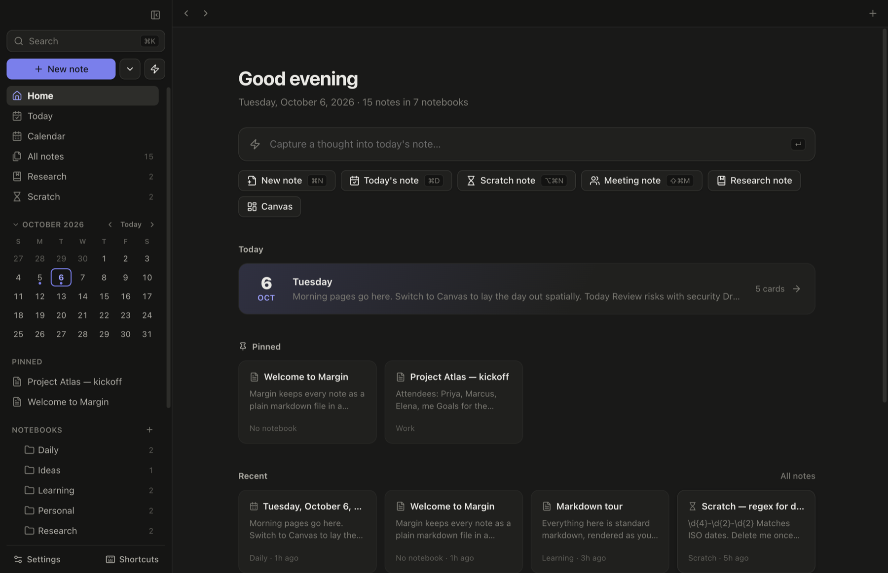

# Margin user guide

Margin is a note-taking app for people who keep a lot of notes: work, meetings, research, things to learn, and quick ideas. Every note is a plain markdown file in a folder on your computer. There is no database and no account.



You can open this guide from inside the app: **Help → User Guide** in the menu bar, the **User guide** button in the shortcuts window (press `?`), or type "guide" in ⌘K. The [design guide](design.md), which explains how Margin is built, is in the same places.

To search a guide, press **⌘F**: a small bar opens at the top right and highlights every match as you type. **Enter** goes to the next match and **⇧Enter** to the previous one (⌘G and ⌘⇧G do the same), and **Esc** closes the bar. **Edit → Find…** does the same from the menu bar while a guide is in front.

To print a guide, choose **Help → Printable Guides…**. It opens a folder with each guide as a PDF and as a web page. The same folder, named **Documentation**, is in the installer's window beside the app.

This guide uses the desktop app's shortcuts. In a browser, most use ⌥ in place of ⌘ (see [Shortcuts](#shortcuts)). Every shortcut can be changed in Settings.

## What Margin can do

Everything the app does, at a glance. Each heading links to the section that explains it.

**[Writing](#writing)**

- Markdown that shows as you type: headings, bold, lists and links look finished, and the raw text appears only on the line you are editing
- Tables you edit in place, with sorting, and paste from and copy to Google Sheets or Excel
- Math formulas, code blocks with syntax colouring, and images and PDFs shown in the note
- Slash commands (`/`) to insert any kind of block, a date, or a template
- Lists that nest, renumber and move with the keyboard, and wrap neatly
- A source mode for the raw markdown, and a read mode with nothing to edit

**[Linking and finding](#finding-things)**

- Links between notes with `[[`, completed as you type, including dates such as `[[next friday]]`
- Backlinks, unlinked mentions and outgoing links beside every note
- One search box (⌘K) for notes, text inside notes, tags, dates and every command, with exact phrases, `in:Notebook`, `is:meeting`, `-word` and other ways to narrow it
- Search inside the note you are in (⌃S), and jump to any heading (⌘⇧O)
- Company short links such as `go/name` and `b/1234567`, clickable as they stand

**[Daily notes](#daily-notes-the-calendar-and-the-canvas)**

- A note for each day, created when you open it, from a template you control
- A journal that shows all your days as one continuous, editable page
- A month calendar, and a small one in the sidebar
- A canvas side to any note: an endless board of cards you can connect

**[Capturing](#quick-capture-and-scratch-notes)**

- Quick capture from anywhere, even from another app, into today's note
- Quick task: capture a task with its dates, priority and tags, with suggestions as you type, into the Inbox
- Scratch notes that remove themselves after a week
- Research notes for articles, with a source link and a reading status

**[Meetings and people](#meeting-notes-and-templates)**

- Meeting notes in one keystroke: named, filed by month and linked from the day
- One running note for each person, for 1:1s, with a list of things to raise next time
- Templates for anything, with dates and times filled in

**[Organising](#organising)**

- Notebooks (folders) that can be nested, and tags with automatic colours
- Tags a notebook gives to every note placed in it
- Pinned notes, recent notes, and a home page
- Two notes side by side, tabs, and back and forward

**[Tasks](#tasks)**

- Any checkbox in any note is a task, with an optional priority, planned day, due date and tags
- A Tasks view that gathers them all: Inbox, Today, Upcoming, Anytime, Someday, Logbook, Overdue and more
- Tasks blocks: a live, tickable list of tasks inside any note, such as everything open for a person or a project
- Repeating tasks (`@repeat(weekly)`) that come back when ticked, and reminders (`@remind(fri 2pm)`) as notifications
- An Inbox, as in Things: captured tasks wait there until you give them a day or move them into a project
- Filters by words, tag and priority; grouping by date, project or priority; and filters you save to the sidebar
- Today's tasks and anything overdue shown at the top of the daily note
- A Top 3 for each day, whose unfinished items move to the next day
- Keys for everything: tick, plan for today, set dates and priority, in a note or in the Tasks view
- [A command-line tool](#tasks-from-the-command-line), `margin-tasks`, for scripts

**[Your files, kept safe](#history-trash-and-export)**

- Every note is a plain markdown file in a folder you choose; no account and no database
- Version history for every note, and a trash for anything deleted
- Export to Markdown, HTML, PDF and Word
- [Import from Obsidian](#importing-from-obsidian), with links, images and canvases

**[Making it yours](#settings)**

- Light and dark themes and a choice of accent colours
- Any installed font, with text size, weight, line spacing and page width
- Colours and sizes for each heading level, bold and italic
- Every shortcut can be changed, and sidebar sections can be hidden

## Contents

The guide has two main parts, because Margin does two different jobs. **Part 1** is about notes. **Part 2** is about tasks.

**Start here**

- [Getting started](#getting-started)
- [Installing and updating on another Mac](#installing-and-updating-on-another-mac)
- [Installing on Linux or a Chromebook](#installing-on-linux-or-a-chromebook)
- [The window](#the-window)
- [How Margin is organised, and why](#how-margin-is-organised-and-why)

**[Part 1: Notes](#part-1-notes)**

- [Writing](#writing)
- [Finding things](#finding-things)
- [Daily notes, the calendar and the canvas](#daily-notes-the-calendar-and-the-canvas)
- [Quick capture and scratch notes](#quick-capture-and-scratch-notes)
  - [Tasks from your phone, through Todoist](#tasks-from-your-phone-through-todoist)
- [Meeting notes and templates](#meeting-notes-and-templates)
- [People and 1:1s](#people-and-11s)
- [Research notes](#research-notes)
- [Organising](#organising)
- [Tabs](#tabs)
- [Two notes side by side](#two-notes-side-by-side)
- [History, trash and export](#history-trash-and-export)
- [Importing from Obsidian](#importing-from-obsidian)

**[Part 2: Tasks](#part-2-tasks)**

- [Tasks](#tasks)
  - [Details on a task](#details-on-a-task)
  - [Cancelling a task](#cancelling-a-task)
  - [The triage note](#the-triage-note)
  - [Repeating tasks](#repeating-tasks)
  - [Reminders](#reminders)
  - [The Tasks view](#the-tasks-view)
  - [Saved filters](#saved-filters)
  - [Tasks blocks: a live list inside a note](#tasks-blocks-a-live-list-inside-a-note)
  - [Moving overdue tasks](#moving-overdue-tasks)
  - [The Top 3](#the-top-3)
  - [Tasks in the daily note](#tasks-in-the-daily-note)
  - [Tasks from the command line](#tasks-from-the-command-line)

**[Reference](#reference)**

- [Settings](#settings)
- [Shortcuts](#shortcuts)
- [Recommended workflows](#recommended-workflows)
- [Where your notes live](#where-your-notes-live)
- [If something goes wrong](#if-something-goes-wrong)

## Getting started

You need [Node.js](https://nodejs.org) 20 or newer.

```bash
npm install
npm run app
```

`npm run app` builds Margin and opens it as a desktop app. The first run creates a `vault` folder with a few example notes.

| Command | What it does |
| --- | --- |
| `npm run app` | Build and open the desktop app |
| `npm run dev` | Run in a browser at http://localhost:4321, reloading as the code changes |
| `npm start` | Build once and serve in a browser |
| `npm run app:dist` | Build an installer for the system you are on, into `release/` |

To use a different notes folder, choose **File → Choose Notes Folder** in the desktop app. Margin restarts and opens the folder you picked, and keeps using it from then on. Nothing is moved: the notes in the old folder stay where they are, so copy them across first if you want them in the new one. The browser version opens the same folder the desktop app uses; to give it a different one, start it with `VAULT_DIR=~/Notes npm start`.

## Installing and updating on another Mac

Margin's releases are on GitHub. A Mac blocks an app downloaded with a browser unless Apple has checked it (notarised it), which costs a paid developer account; that is why the release notes say to run `xattr -cr` after every install. **`margin-update`** avoids this: it downloads the release with GitHub's own tools instead of a browser, so the Mac never marks it, and installs it into Applications. One setup per Mac, then one command per update.

The repository is private, so the Mac has to be signed in to GitHub. Pick one of the two ways below. **Way B needs nothing installed**, so it suits a work laptop where you cannot add software.

### Way A: with the GitHub command-line tool

Use this if you have [Homebrew](https://brew.sh) or already use `gh`.

1. Open **Terminal**.
2. Install the GitHub command-line tool, if it is not there yet:

   ```bash
   brew install gh
   ```

3. Sign in once. Choose **GitHub.com**, **HTTPS**, and **Login with a web browser**, then paste the code it shows into the page that opens:

   ```bash
   gh auth login
   ```

4. Fetch and run the installer script:

   ```bash
   gh api repos/vimishra/margin/contents/scripts/install-latest.sh -H "Accept: application/vnd.github.raw" > /tmp/margin-update; bash /tmp/margin-update
   ```

### Way B: with a GitHub token (nothing to install)

1. On any computer, sign in to GitHub and go to **Settings → Developer settings → Personal access tokens → Fine-grained tokens → Generate new token**.
2. Fill it in:
   - **Token name:** `Margin updates on my work laptop`
   - **Expiration:** as long as you like; when it runs out, make a new one and repeat step 4.
   - **Repository access:** **Only select repositories**, and pick **vimishra/margin**.
   - **Permissions → Repository permissions → Contents:** **Read-only**. Leave everything else at No access.
3. Click **Generate token** and copy it. GitHub shows it only once.
4. On the Mac, open **Terminal** and save the token from the clipboard into a file only you can read (pasting from the clipboard keeps it out of your Terminal history):

   ```bash
   mkdir -p ~/.config/margin; pbpaste > ~/.config/margin/github-token; chmod 600 ~/.config/margin/github-token
   ```

5. Fetch and run the installer script:

   ```bash
   curl -fsSL -H "Authorization: Bearer $(cat ~/.config/margin/github-token)" -H "Accept: application/vnd.github.raw" https://api.github.com/repos/vimishra/margin/contents/scripts/install-latest.sh -o /tmp/margin-update; bash /tmp/margin-update
   ```

### What happens, and updating later

The script downloads the newest installer, closes Margin if it is open (your notes are already saved), puts the new version in Applications, and opens it. Your notes and settings are kept. It also saves itself as `~/.local/bin/margin-update`.

From then on, to update, open Terminal and run:

```bash
margin-update
```

To install a particular version instead of the newest, add it: `margin-update 1.18.1`.

If Terminal says `margin-update: command not found`, `~/.local/bin` is not on your PATH yet. Either run it as `~/.local/bin/margin-update`, or add the folder once: in zsh (the Mac's usual shell) run `echo 'export PATH="$HOME/.local/bin:$PATH"' >> ~/.zshrc` and open a new Terminal window; in fish run `fish_add_path ~/.local/bin`. The same folder holds `margin-tasks` (see [Tasks from the command line](#tasks-from-the-command-line)).

**If it stops with a message:**

- *not signed in to GitHub*: do step 3 of Way A, or steps 1 to 4 of Way B.
- *could not read the release from GitHub*: the token has expired or cannot see the repository. Make a new one (Way B, steps 1 to 4).
- *Margin is still open*: quit Margin yourself and run the command again.
- *this Mac has an Intel processor*: the releases are built for Apple silicon only.

An installer downloaded in a browser still works as before: drag Margin into Applications and run `xattr -cr /Applications/Margin.app` once.

## Installing on Linux or a Chromebook

Each release also has a Linux package, `margin-notes_<version>_amd64.deb`, for 64-bit Intel or AMD computers running Debian or Ubuntu, including the Linux environment on a Chromebook. It needs no extra steps of the `xattr` kind.

**On a Chromebook:**

1. Turn on Linux once, if it is not on yet: **Settings → About ChromeOS → Developers → Linux development environment → Set up**.
2. On the [releases page](https://github.com/vimishra/margin/releases), open the newest release and download the `.deb` file.
3. Open the **Files** app, go to **Downloads**, right-click the `.deb` and choose **Install with Linux**. Click **Install** and wait for it to finish.
4. Open **Margin** from the launcher; it is in the **Linux apps** folder. You can pin it to the shelf like any app.

**On Debian or Ubuntu:** download the `.deb`, then in a terminal, in the folder you saved it to, run `sudo apt install ./margin-notes_<version>_amd64.deb`. Open Margin from the applications menu, or run `margin`.

**Updating:** install the newer `.deb` the same way; your notes and settings are kept. `margin-update` is for Macs only.

If a Chromebook keeps showing a generic icon for Margin after an update, it is showing a remembered one: right-click the Terminal icon on the shelf, choose **Shut down Linux**, and open Margin again.

**Notes on Linux:**

- New notes go to `~/Documents/Margin` until you choose a folder with **File → Choose Notes Folder**. On a Chromebook that folder is inside Linux; to keep notes in the Chromebook's own **My files** instead, share a folder with Linux in the Files app (right-click → **Share with Linux**), then choose it under `/mnt/chromeos/MyFiles/`.
- Shortcuts use **Ctrl** where this guide says ⌘, and **Alt** where it says ⌥.
- **Help → Command-Line Tool…** installs `margin-tasks` in `~/.local/bin`, as on a Mac.
- The printable guides are in `/opt/Margin/resources/Documentation`.


## The window

- **Sidebar** on the left: search, the New note button, Home, Today, Journal, Calendar, All notes, Tasks, Research, Scratch, a small calendar, your pinned notes, the five notes you opened most recently, notebooks and tags. ⌘\ hides it. Drag its right edge to make it wider or narrower; double-click the edge to go back to the usual width.
- **Tabs** along the top: every note you open stays in a tab. ⌘⇧[ and ⌘⇧] move between them, ⌥1–9 jump to one, ⌘W closes one.
- **The note** in the middle, with its title, tags, a formatting toolbar and the text.
- **The side panel** on the right of a note: backlinks, unlinked mentions, outgoing links, an outline and file details. ⌘. hides it.

**Home** shows today's note, your pinned notes, recently opened notes, your reading queue and scratch notes that are about to expire.

Back and forward work as in a browser: ⌘[ and ⌘], the mouse's back and forward buttons, or the arrows at the left of the tab bar.

## How Margin is organised, and why

Margin has a handful of ways to organise notes. This chapter explains what each is for, why it exists, and which ones you can ignore.

### The short version

- A **notebook** says where a note lives. A note is in exactly one.
- A **tag** says what kind of thing a note is. A note can have many.
- A **link** says what a note is related to. It is the most specific of the three.
- **Search** finds everything else.

If you only remember one thing: put notes in a few broad notebooks, link generously, and let search and backlinks do the rest.

### Notebooks

**What they are.** A notebook is a folder inside your notes folder. `Work/Atlas plan.md` is a note called "Atlas plan" in the notebook "Work".

**Why they exist.** Every note is a file, and a file has to be in some folder. Notebooks are simply those folders, shown in the sidebar. They are not a feature added on top; they are what the files already are. That is also why they keep working outside Margin: open the notes folder in Finder and the notebooks are right there.

**What they are good for.**

- Separating areas of your life that rarely mix: Work, Personal, Learning.
- Keeping generated notes out of the way: Daily, Meetings, Inbox, Templates, Scratch and Assets are notebooks Margin files things into for you (see the table below).
- Scoping a list. Clicking a notebook shows only what is in it.

**What they are bad at.** A note can only be in one notebook, but most notes belong to several topics. A meeting about the Atlas project with a vendor is "Meetings", "Atlas" and "Vendors" all at once. Trying to express that with folders leads to deep trees and time lost deciding where things go.

**How to use them well.**

- Keep to very few, one per area of your life, as Things has areas. For most people **Work** and **People** are enough; add **Personal** if you want a second area.
- Make each project one note inside its area: `Work/Organization`, `Work/Atlas`. See [Projects and areas](#projects-and-areas).
- Avoid nesting more than one level, except where Margin does it for you (Meetings by year and month).
- If you cannot decide where a note goes, leave it at the top level, or write it in today's note. It is still found by search, links and tags. (The Inbox notebook is for tasks, not notes.)
- Use tags and links for topics; use links for projects and people.

The notebooks Margin manages. You do not need to open or organise these; Margin creates them and files into them:

| Notebook | What goes there |
| --- | --- |
| Daily | One note per day, made by ⌘D or the journal |
| Meetings | Meeting notes, filed as Meetings/2026/Oct |
| Inbox | The Inbox note, where Quick task puts tasks |
| Templates | The daily and meeting templates, and your own |
| Scratch | Notes that remove themselves after a while |
| Assets | Pasted images and attached files (the name is a setting) |

So a simple notes folder looks like this:

```
Work/        one note per project: Organization, Atlas, …
People/      one note per person, for 1:1s
Archive/     finished projects (optional)
Daily/  Meetings/  Inbox/  Templates/  Scratch/  Assets/    managed by Margin
```

### Projects and areas

Margin follows Things 3 here, with notes instead of a separate task database:

| Things 3 | Margin |
| --- | --- |
| Area, such as Work | A notebook: `Work` |
| Project, such as Organization | A note in that notebook: `Work/Organization` |
| Heading inside a project | A `##` heading inside the note |
| To-do | A `- [ ] …` line in the note |
| Notes on a to-do | Lines indented under the task |
| Inbox | The *Inbox* note in the Inbox notebook |
| Moving an Inbox to-do into a project | **M** in the Tasks view: it goes under the project note's **Open Threads** heading |
| A project's to-dos in one place | The Tasks view grouped by **Project**, with a circle that fills as they are ticked |
| A project deadline | `@due(…)` on the one task that means the project is done |
| Completing a project | Tick its last tasks, then **Move this note to the Archive** (⌘K) |

A project is anything with more than one step that ends when an outcome is reached. A project note is more than a task list: decisions, links and background go in the same note, around the tasks.

#### Shaping a project note

A shape that works, for a project note called *Project Goldilocks* in `Work`, with its to-dos in one part and its background in another:

```markdown
Outcome: 1.0 schedule and resourcing agreed by 15 Nov.

## Tasks
### Close the schedule with the new feature list
- [ ] Review the final feature list
- [ ] Close the 0.2 milestone schedule
- [ ] Close the 0.5 milestone schedule
- [ ] Close the 1.0 milestone schedule @due(2026-11-15)
### Close the resourcing
- [ ] Close the resourcing for feature A
- [ ] Close the resourcing for feature B
### Open Threads

## Notes
### Feature A details
### Feature B details

## Log
- 29 Oct: feature list frozen for 1.0
```

- **No title heading.** The note's title is already its name, shown above the page and used as the file name, so a `# Project Goldilocks` line would only repeat it.
- **Outcome first,** in one line: what "done" means. It is what makes the note a project rather than a list.
- **A `###` heading for each phase under Tasks,** as Things uses headings. In the Tasks view each task shows its heading (*Project Goldilocks › Close the resourcing*), and grouped by Project the tasks are listed under these headings. Most tasks need no date: they wait in Anytime. Plan only the next one or two with a day (`>date`), so Today stays short.
- **Open Threads inside Tasks.** **M** files a task under the note's Open Threads heading, at whatever level it is, so filed tasks land next to the others; sort them into the phases now and then. Without one, Margin adds `## Open Threads` at the end of the note, below the notes.
- **Notes** for background, one `###` per topic. A task about one feature can also sit under its notes; it still belongs to the project and shows that heading in the Tasks view.
- **Log** for decisions and dated context, newest last, so the note is the project's whole memory, not only its to-do list.
- **The deadline** goes on the task that marks the end, here the 1.0 schedule. It shows in This week and Next 30 days as it comes near, joins Today on the day, and is marked overdue if it slips.
- **Fold what you are not working on:** fold `## Notes` while going through the tasks, or a phase once it is done (⌘', or the arrow beside the heading).

To reuse the shape, save it without the details as a note called *Project* in the Templates notebook, and start each project with ⌘K → "New note from a template".

To start a project, make the note in its area's notebook, or press **M** on an Inbox task and type a new name: Margin makes the note with an Open Threads heading and the task under it. How to keep projects moving week to week is in the [theory of operations](operations.md#tasks-projects).

Not every note is a project. Daily notes, meeting notes, the Inbox, templates, scratch notes and notes in **People** are not. A meeting's actions still belong to its project: when a meeting note links `[[Organization]]`, its tasks are listed under Organization in the Tasks view (grouped by Project), after Organization's own tasks, under "From" and the meeting's name. They stay in the meeting note, where the context is; ticking one there or in the Tasks view is the same thing. A task in any other note, such as today's, joins a project by linking it on its own line: `- [ ] Ring the recruiter [[Organization]]`. To move a task into the project note for good, press **M** on it in the Tasks view.

### Tags and links

**Tags** answer "what kind of note is this?" or "what state is it in?": `#meeting`, `#idea`, `#question`, `#todo`. They cut across notebooks, and a note can carry several.

**Links** answer "what is this about?". Writing `[[Atlas]]` in a meeting note connects the two, and the Atlas note's backlinks then list every note that mentions it. This is what replaces deep folder trees: you do not file the meeting under Atlas, you mention Atlas in it.

| To say | Use | Example |
| --- | --- | --- |
| Where it lives | Notebook | Work |
| What kind of thing it is | Tag | `#meeting` |
| What it relates to | Link | `[[Atlas]]`, `[[Priya]]` |
| That I need it close at hand | Pin | |

### The kinds of note

Every note is an ordinary markdown file. A few kinds get extra behaviour, switched on by one line at the top of the file. Remove that line and it is a plain note again.

| Kind | What it adds | Why it exists |
| --- | --- | --- |
| **Daily note** | Named for its date, shown on the calendar, one key to open today's, the default place captures land | You need somewhere to write when you do not yet know where something belongs. The date is a name you never have to think of. |
| **Scratch note** | An expiry date; it moves to the trash by itself | Much of what you jot down is only needed for a few days. Without an expiry, it piles up and buries the notes that matter. |
| **Research note** | A source link, a status (Unread, Reading, Done), a list filtered by status, a reading queue on Home | To keep a source and your thinking about it together, and to see what you have not finished reading. |
| **Meeting note** | Nothing special in the file. It is a plain note made from a template, filed by date, tagged `#meeting` and linked from that day | Meetings happen often and always have the same shape, so making one should take one keystroke. |
| **Canvas** | Not a kind of note: every note has a page and a canvas | Some thinking is spatial. |

### Do you need research notes?

No. Be honest with yourself about whether you would use the reading status.

A research note is a normal note with two extra fields. Its whole value is the queue: seeing at a glance what is unread, what you are part-way through, and what is done. If you collect articles, papers or documentation and want to track your way through them, that is useful.

If you do not, ignore the Research section entirely. An ordinary note with the link pasted in, and perhaps a `#reading` tag, does the same job with less ceremony. Nothing else in Margin depends on research notes.

The same goes for scratch notes and the canvas. They cost nothing if unused.

To take a section you do not use out of view, switch it off in **Settings → General → Sidebar sections**. That hides it from the sidebar and from Home. The notes themselves are untouched and still turn up in search.

### What you cannot skip

Only two things are structural:

- **The notes folder**, because that is where the files are.
- **Titles**, because links go by title. Two notes with the same title make a link ambiguous, so keep titles distinct.

Everything else is optional.

---

# Part 1: Notes

Everything about writing things down and finding them again: the editor, search, daily notes, capture, meetings, people, research and keeping the collection organised.

## Writing

### Live preview

Notes render as you type. The line your cursor is on shows its markdown; every other line shows the result. So `**bold**` becomes **bold** when you move off the line.

The buttons at the top right of a note switch between three modes:

- **Write** (live preview), the default
- **Markdown source**, the raw text
- **Read**, a read-only page. ⌘E switches between Write and Read. Each line shows as you wrote it: a new line in the note is a new line on the page, so notes under a task or an image under a list item sit below it, not beside it. The same goes for exports.

### What you can write

| To get | Type |
| --- | --- |
| Heading | `# `, `## `, `### ` at the start of a line |
| Bold, italic, strikethrough | `**bold**`, `*italic*`, `~~struck~~` |
| Bulleted or numbered list | `- item` or `1. item` |
| Task | `- [ ] task`; click the box to tick it |
| Quote | `> quote` |
| Inline code, code block | `` `code` ``, or three backticks and a language on their own line |
| Link to a note | `[[Note title]]` |
| Web link | `[text](https://example.com)`, ⌘L, or just paste the address |
| Tag | `#tag` anywhere in the text |
| Inline math | `$e^{i\pi} + 1 = 0$` |
| Display math | `$$` on its own line, the formula, `$$` on its own line |
| Table | `/table`, or write it in markdown |
| Divider | `---` on its own line |

Code blocks are coloured for the language you name. Math uses LaTeX syntax.

### Slash commands

Type `/` at the start of a line or after a space. A menu appears; keep typing to narrow it and press Enter.

- **Blocks:** Heading 1–3, Bulleted list, Numbered list, Task, Quote, Text. These change the line you are on and keep its text.
- **Insert:** Code block, Table, Math block, Inline math, Divider, Link to a note, Web link, Image or file.
- **Dates:** Today, Tomorrow, Yesterday (links to that day's note), Date, Time.
- **Templates:** one entry per template; it inserts the template's text.

### Headings

⌘1 to ⌘5 turn the current line into a heading of that level. Pressing the same one again turns it back into plain text, and a different one changes the level. With several lines selected, each becomes a heading.

### Lists

- **Tab** nests an item under the one above. **⇧Tab** moves it back out. Numbering fixes itself.
- **⌥↑** and **⌥↓** move an item up or down past its neighbour, taking its sub-items along.
- **⌘⇧8**, **⌘⇧7**, **⌘⇧9** turn lines into a bulleted, numbered or task list, and back.
- **⌃A** goes to the start of the text; pressed again, to the very start of the line.

Nested levels show a faint guide line. The indent width and the guides are in Settings → Appearance. Other lines inside an item, such as notes under a task or an image, line up with the item's text whatever spaces the file uses.

### Folding

A section (a heading and everything under it, down to the next heading of the same or a higher level) or a list item with lines indented under it can be folded down to its first line. Hover over the line and click the small arrow to its left; a folded line always shows a solid arrow in the accent colour, pointing right, and three bold, tinted dots (**…**) at its end, so folded places are easy to spot. Click either to unfold.

- **⌘'** folds or unfolds where the cursor is. Inside a section's text, it folds that section.
- **⌘⌥↑** folds. Pressed again, it folds the next section or item out, so a few presses collapse a long note down to its main headings.
- **⌘⌥↓** unfolds the fold on the cursor's line.
- **Fold All** and **Unfold All** are in the Format menu and ⌘K. They fold every top-level section and list item.

**Folding by outline, as in org-mode.** With the cursor on a heading line:

- **Tab** cycles that section: *folded* (just the heading) → *its subheadings* (each folded, so you see the section's outline) → *everything* → folded again. A section with no subheadings goes from folded straight to open.
- **⇧Tab** cycles the whole note: *top headings only* → *every heading, no text* → *everything* → top headings again. The cursor can be on any heading.
- **Fold below this level** (⌘K or the Format menu) keeps every heading down to the level of the heading you are in and folds the rest. In a `##` section you see all the `#` and `##` headings, with everything under each `##` folded.
- **Fold to level 1, 2 or 3** does the same for that level, wherever the cursor is.

Off a heading line, Tab and ⇧Tab work as before: they nest and un-nest list items, and move between table cells. To use Tab only for indenting, turn off **Settings → Editor → Tab folds headings**. Each of these commands can have a shortcut in Settings → Shortcuts.

Folding never changes the note. It is remembered for each note on this computer, so a note opens the way you left it, and tasks in a folded section still show in the Tasks view. Find, Jump to a heading and links to a section open any fold they land in. Paragraphs, tables and code blocks do not fold, and the read-only view and exports always show everything.

### Tables

Tables are edited in place. Click a cell and type.

- **Tab** and **⇧Tab** move between cells; **Enter** moves down. Both add a row at the end.
- The **+** bars on the right and bottom edges add a column or a row.
- **Right-click** a cell to insert or delete rows and columns, set alignment, or **sort** the table by that column, A to Z or Z to A. You can also sort from the header: hover a column's heading and click the arrow at its right edge; click again to reverse. The arrow stays visible on the column the table is currently sorted by. Numbers sort as numbers, and empty cells go to the bottom. Sorting reorders the rows in the note itself; ⌘Z undoes it.
- **Width:** a table is only as wide as its contents need. To stretch every table across the page instead, choose Full width in Settings → Appearance → Table width.
- **Edit markdown** (top right, on hover) shows the raw table. Click **Done**, or move the cursor out, to return.

**Working with a spreadsheet.** For anything more than a small table, edit it in Google Sheets, Excel or Numbers and bring it back:

- **From a spreadsheet:** select the cells, copy, and paste into a note. They become a markdown table. The first row is the header, and a column that holds only numbers is right-aligned. Tables copied from a web page work the same way.
- **To a spreadsheet:** hover the table and click **Copy for spreadsheet**, then paste into the sheet. The cells arrive as cells.
- **Round trip:** copy the table out, edit it in the sheet, copy it back, and paste it over the old one (use **Edit markdown** and select the old table first, or delete it and paste).

In the file, every table is written with its columns padded so the pipes line up in a fixed-width font, in markdown source mode and in any other editor:

```
| Block   | Owner   | Power (mW) |
| ------- | ------- | ---------: |
| Mempath | Shankar |         30 |
| LPCM    | Priya   |      1,200 |
```

Formulas come across as their results, and formatting such as colours, bold and merged cells is dropped. Pasting inside a code block is left as plain text.

### Images and files

Paste or drop an image, PDF or any file into a note. It is saved in your attachments folder and linked from the note.

- **Click** an image to see it larger. Esc closes it.
- **Edit**, a small button on hover, shows the image's markdown.
- **Size:** a pasted Retina screenshot is shown at the size it was on screen. The width is the number after `|` in the markdown, for example ``. Change or remove it to resize.
- **In a list:** pasted at the end of a list item's line, the image goes on the next line indented to that item, so it belongs to it and shows under the item's text at any depth. On an empty line it goes where the cursor is.
- **Names:** a pasted image is named after the note and the time, for example `Atlas-kickoff-2026-10-06-1654.png`.
- **Border:** Settings → Appearance → Image border offers None, Hairline or Shadow.

### Links

- Type `[[` and pick a note. Typing a date phrase works too: `[[tomorrow`, `[[next friday`.
- Click a link to open it. ⌘-click opens it in the other pane.
- A link to a note that does not exist yet is shown outlined; clicking it creates the note.
- To edit a link, put the cursor on its line first; then a click places the cursor and ⌘-click opens.
- Renaming a note updates every link to it.
- **Web links:** ⌘L inserts `[]()` with the cursor between the square brackets, ready for the link's text. With words selected it wraps them and puts the cursor in the round brackets for the address.
- **Short links:** company short links written as plain text are clickable as they stand: `go/some-name`, `b/1234567` and `b/hotlists/1234567`. Clicking one opens `http://go/some-name` (or `http://b/…`) in your browser. The text in the note is not changed. They are recognised in the editor, read mode, canvas cards and the Tasks view, but not inside code, web addresses or existing links. Turn this off in Settings → Editor → Short links.
- **Paste to link:** select some words and paste a web address. The words become a link to it. This does not happen inside code or an existing link.

### Right-click and the Format menu

In the desktop app, right-clicking a task (or a selection of tasks) puts what you can do to it at the top of the menu: **Mark as Done** (or Not Done), **Cancel Task** (or Reopen), **Move to Today**, **When…**, **Due Date…** and **Change Priority**. They act on the task you clicked, not wherever the cursor was, and on every selected task when you click inside a selection. Right-clicking in a note also offers spelling suggestions, Cut, Copy and Paste, Look Up, "Search Notes for…", and Format, Paragraph and Insert menus. Right-clicking a link offers Open, Open to the Side and Copy Link.

The same commands are in the menu bar under **Format**, for the note you are editing, in one list with no submenus. Lines divide it into groups:

- **Bold** (⌘B), **Italic** (⌘I), **Strikethrough**, **Inline Code**. They wrap the selected text; a space or line end selected at either end stays outside the marks, since markdown does not make `**word **` bold. They also switch the style off: on text that is already bold (or italic, struck or code), with it selected or the cursor anywhere inside it, the same key or menu item takes the marks off that stretch. Bold and italic together (`***word***`) lose only the one you choose.
- Heading 1 to 5
- Bulleted, Numbered and Task List, Quote, Code Block
- Link to a Note (⌘⇧K), Web Link, Table, Math, Divider
- Today's Date, Current Time
- Tick or Untick Task, Move Task to Today, Task When…, Task Due Date…, Change Task Priority
- Fold or Unfold, Fold, Unfold, Fold All, Unfold All

The menu shows each command's shortcut, including ones you have changed in Settings → Shortcuts. With no note open, the commands do nothing.

## Finding things

### Search everything: ⌘K

⌘K opens one box that searches, switches notes and runs commands.

- **Empty:** recently opened notes. The first is the note you were in before, so ⌘K then Enter flips between two notes.
- **Words:** full-text search across all notes. Opening a result scrolls to the match.
- **Tasks:** the same words also find tasks. Below the best three notes, a **Tasks** group lists up to five tasks whose text contains every word, open ones first (most urgent first), then finished ones. Each shows its note, priority and dates. `#tag` and `p1`–`p3` narrow them as in the Tasks view: `p1 bank` finds high-priority tasks mentioning the bank. Enter opens the task's note with the cursor at the end of the task; ⌥↵ opens it in the side pane. To tick or reschedule, use the Tasks view.
- **`#tag`:** only notes with that tag.
- **Narrowing down:** a few words of their own narrow any search. Combine them freely with ordinary words:

  | Type | Finds |
  | --- | --- |
  | `"budget review"` | Notes with exactly that phrase |
  | `-draft`, `-"old plan"`, `-#archive` | Leaves out notes with that word, phrase or tag |
  | `in:Work`, `in:"Work/Atlas"` | Only notes in that notebook, and the notebooks inside it |
  | `title:kickoff` | Only notes whose title has that word |
  | `is:meeting`, `is:daily`, `is:research`, `is:scratch` | Only that kind of note |
  | `has:tasks` | Only notes with open tasks |
  | `after:2026-10-01`, `before:friday` | A daily note's day, or the day a note last changed |

  For example, `is:meeting after:"last monday" priya` finds this week's meetings that mention Priya, and `in:Work "capacity numbers"` finds where that phrase came up at work. The heading over the results says what the search is limited to, and anything it did not understand, such as a misspelt `colour:red`. Tasks in the results follow the same filters. Opening a result takes you to the phrase you searched for.
- **A date:** `today`, `tomorrow`, `friday`, `next monday`, `last friday`, `06/10`, `6 oct`, `in 3 days`. The first result is that day's daily note.
- **A command:** type what you want to do. `rename`, `delete`, `duplicate`, `close other`, `add tag`, `copy link`, `export`. A matching command appears at the top; press Enter.
- **A task list:** `inbox`, `today`, `upcoming`, `anytime`, `someday`, `logbook`, `overdue` and the others, or the name of a saved filter. **Tasks: Inbox** and the rest appear at the top; Enter opens that list.
- **`>`:** commands only.
- **⌥↵** opens the selected note in the side pane. **⌘↵** creates a note named with what you typed.

Commands act on the note in the active pane. The ones people reach for most:

| Type | Does |
| --- | --- |
| `rename` | Rename this note (also F2). Links to it are updated. |
| `delete` | Move this note to the trash, with Undo |
| `duplicate` | Make a copy |
| `add tag` | Add one or more tags |
| `copy link` | Copy `[[Title]]` to paste into another note |
| `close other` / `close all` | Close the other tabs, or all of them. Close all is offered from any view while tabs are open; close other needs a note in front, since that is the tab it keeps. Right-clicking a tab offers the same. |
| `move` | Move to another notebook |
| `open to the side` | Show this note in the side pane |
| `history`, `export` | Version history; export as PDF, Markdown, HTML or Word |
| `theme`, `settings`, `page width` | Change how the app looks |

### Search inside a note: ⌃S

⌃S opens a small search bar at the bottom of the note. Matches highlight as you type and the bar shows a count.

- **⌃S** next match, **⌃R** previous match (⌃R also starts a backward search).
- **Enter** jumps to the match and closes the bar. **Esc** cancels and returns to where you were.
- Lowercase ignores case; one capital letter makes the search exact.

⌘F opens find and replace. ⌘F always finds in what is in front: in a note, this find and replace bar; in the Tasks view or a list of notes, its narrow-down box; in a guide, the guide's find bar; in the shortcuts window, its find box; anywhere else, ⌘K's search. **Edit → Find…** in the menu bar does the same.

### Jump to a heading: ⌘⇧O

Lists the headings in the note. Type to filter, Enter to jump. The Outline in the side panel does the same with the mouse.

### Backlinks

The side panel on the right of a note shows how it connects to the rest:

- **Backlinks:** every note that links to this one, with the line the link is on.
- **Unlinked mentions:** notes that contain this note's title as plain text, without a link. **Link** turns the mentions in that note into links, so they become backlinks. Titles shorter than three letters and daily notes are skipped.
- **Outgoing links:** the notes this one links to, then the web addresses in it. A note that does not exist yet is marked *create*.

## Daily notes, the calendar and the canvas

**Today** in the sidebar (⌘D) opens today's daily note, creating it if needed. Daily notes are stored as `Daily/2026-10-06.md`.

Every note has two sides, switched with the **Page / Canvas** buttons:

- **Page:** ordinary text.
- **Canvas:** an endless board of cards. Daily notes open on the canvas by default.

On the canvas:

- **Double-click** empty space to add a card; double-click a card to edit it. Cards are markdown.
- **Drag** a card to move it; drag its corner to resize.
- Drag the **dot** on a card's edge to another card to connect them, or to empty space to make a connected card.
- **Scroll** to pan; pinch or ⌘-scroll to zoom.
- Paste or drop images and files to add them as cards.
- Select a card for colours, duplicate and delete. ⌫ deletes the selection.

**Journal** in the sidebar (⌘J) shows your daily notes as one continuous page, today at the top and earlier days below. Scrolling down loads more.

- Every day is editable in place: click into any day and write. It is the same daily note, so nothing is copied.
- Each day shows its **Tasks for this day** panel, and today's also lists what is overdue.
- Only days that have a note appear, and days in the future are left out. Today is always there.
- Click a day's date to open it on its own; ⌘-click opens it beside the journal.
- Formatting shortcuts, ⌘K commands and search-in-note apply to the day you last clicked in.
- A day that also has a canvas shows a **Canvas** button. The journal shows only the page side.

**Calendar** shows a month. Days with a daily note have a dot. Click a day to see it; press Enter or double-click to open it. The small calendar in the sidebar opens a day's note with one click.

## Quick capture and scratch notes

**Quick capture** (⌘⇧C, or ⌃⌥N from any app) opens a small box. Type, press Enter, and carry on with what you were doing. A note always goes into **today's note**: as a timestamped line (Settings → Capture & scratch → Timestamp captures), or as a card if today is on the canvas. ⇧Enter starts a new line.

To capture a task, use **Quick task** below: tasks go to the Inbox, not to today's note.

### Quick task

**Quick task** (⌘⌥C, or ⌃⌥Space from any app) opens the same box ready for a task. The **Note / Task** switch at the top changes between the two, and so do their shortcuts while the box is open; what you have typed comes along.

Type the task with its details, as you would on a task line in a note, and the same suggestions appear:

| Type | Suggests |
| --- | --- |
| `>` and a day in words (`>fri`, `>next week`), or `>some` | When: the planned day, or Someday |
| `@due(` and a day in words | The due date |
| `P` after a space | P1, P2, P3 |
| `#` | Your tags |
| `[[` | A note to link |

You do not have to pick a suggestion: when the task is saved, `>fri` and `@due(next week)` are turned into the dates they mean. The line under the box shows what Margin understood (When Tomorrow, Due Fri 16 Oct, P2, #atlas) before you save.

- **Enter** saves the task and closes the box. **⇧Enter** saves it and keeps the box open for the next one.
- **Tab** moves down to **Notes**, for anything that belongs with the task: context, a link, a few bullets. There, **Enter** starts a new line, **⌘↵** saves, **⇧⌘↵** saves and starts another, and **⇧Tab** goes back up to the task. The notes are saved on the lines under the task, indented, so they stay with it when you tick it or move it with **M**. Blank lines are left out, since a blank line would cut the notes off from the task.
- Every task goes to the end of the **Inbox note**: the note called *Inbox* in your Inbox notebook, made the first time it is needed.
- With no day, it waits in the **Inbox** list until you decide on it (see [The Inbox](#the-inbox)). If you typed a day (`>fri`) or Someday, it shows in Today, Upcoming or Someday instead; the line under the box tells you which before you save.
- Esc closes a suggestion list first, then the box.

Captured tasks appear in **Tasks → Inbox**, where you sort them: see [The Inbox](#the-inbox).

### Tasks from your phone, through Todoist

Margin has no phone app, but tasks you add to **Todoist** on your phone (with its widget, Siri or Google Assistant, or the share sheet) can come into Margin by themselves. Margin moves them: each task is added to your Inbox note and then completed in Todoist, so it is only ever in one place.

**Set it up once:**

1. In Todoist, make a project called **Margin** (or pick a label, such as `margin`, if you would rather tag tasks from any project). On the phone, add tasks to that project: in Todoist's quick add, type `#Margin`, or make it the project for the Todoist widget.
2. In Todoist on the web or desktop, open **Settings → Integrations → Developer** and copy the **API token**.
3. In Margin, open **Settings → Capture & scratch**, paste the token under **Todoist API token** and choose **Connect**. Margin checks it with Todoist. **Bring in tasks from Todoist** turns on.
4. If your project has another name, or you use a label, set **Todoist project** and **Todoist label**. Either or both.

**Then:** every five minutes while Margin is running (also when you come back to its window, and at start), waiting tasks move into the Inbox note. A message says how many came in. To check straight away, choose **Todoist: check for new tasks now** in ⌘K (you can give it a shortcut in Settings → Shortcuts), or **Check now** in the settings, where the line beside it says what the last check did.

Every task that comes in is tagged **#todoist**, so you can find the ones you jotted down quickly and reword them: narrow the Tasks view to `#todoist` (and save it as a filter, say "From my phone"), or put a tasks block with `#todoist` in a note. Once a task is reworded, remove the tag.

How a Todoist task comes in:

| In Todoist | In Margin |
| --- | --- |
| The task | A task in the Inbox note |
| p1, p2, p3 | `P1`, `P2`, `P3` |
| A date (the day you plan to do it) | The planned day, `>2026-11-12`, so it shows in Today or Upcoming |
| A time on that date | A reminder, `@remind(2026-11-12 17:30)` |
| A deadline | The due date, `@due(2026-11-20)` |
| Labels (other than the one you import by) | Tags, such as `#health`, besides `#todoist` |
| The description | Notes under the task |
| Sub-tasks | Sub-tasks under it |

- **Repeating Todoist tasks are left in Todoist**: completing one there only moves it to its next date, so it would come in again each time. The check says how many it left. Add the repeat in Margin instead (`@repeat(…)`).
- **Margin has to be running** on a computer for tasks to come in; until then they wait safely in Todoist.
- **Turn it on on one computer only.** The settings and the token are kept on each computer separately, never in your notes folder; if two computers both brought tasks in, they could both take the same one.
- **Nothing is lost if something fails.** Tasks are completed in Todoist only after the Inbox note is saved. If completing fails, Margin remembers it already has them and tries again next time, without adding them twice.
- To stop, turn **Bring in tasks from Todoist** off, or **Remove** the token.

**Scratch notes** (⌘⌥N, or New → Scratch note) are for things you need for a few days. They expire after a week and move to the trash. Each one shows how long it has left, with buttons to extend it or **Keep** it as a normal note.

## Meeting notes and templates

**New meeting note** (⌘⇧M) asks for the meeting's name, then:

- creates the note in `Meetings/2026/Oct/`
- fills in the meeting template and tags it `#meeting`
- adds a timestamped link to it in today's daily note

**Templates** are ordinary notes in the `Templates` notebook. Edit one like any note. To use one, choose **New → From a template…**, or type `/template` in a note.

Templates can contain placeholders that are filled in when the note is made:

| Placeholder | Becomes |
| --- | --- |
| `{{date}}` | 2026-10-06 |
| `{{time}}` | 16:54, or 4:54 PM (your Time format setting) |
| `{{day}}` | Tuesday |
| `{{title}}` | The note's or meeting's name |
| `{{date:ddd, Do MMM}}` | Tue, 6th Oct |
| `{{time:h:mmA}}` | 4:54PM |

**Daily notes** start from the note called `Daily` in the Templates notebook. Margin creates it the first time a daily note is needed, with a "Top 3" checklist and a "Log" section. Edit it like any note to change what each day starts with; empty it for blank daily notes. Because it is a note, it travels with your notes folder to another computer.

- **The Top 3 carries forward.** When today's note is created, anything left unticked in the last day's Top 3 is moved into today's, with anything nested under it. Ticked items, and ones you struck through, stay where they were. An item written without a checkbox is carried too, and becomes a checkbox so it can be ticked. If today's note already exists, run "Move unfinished Top 3 to today" from ⌘K. Turn the automatic move off in Settings → Daily notes.
- Placeholders are filled in for the day the note is for, so a note for next Tuesday says Tuesday.
- Tags on the `Daily` note are given to each new daily note.
- The template is applied when a daily note is first created, whichever way that happens: Today, the calendar, the journal, quick capture, or a link such as `[[tomorrow]]`.
- Daily notes that already exist are not changed. To add the template to one, type `/template` in it.
- If you typed a template into Settings → Daily notes before, it is still used as long as there is no `Daily` note.

The format letters are the same as Obsidian's: `YYYY`, `MMMM`, `MMM`, `MM`, `Do`, `DD`, `dddd`, `ddd`, `HH`, `h`, `mm`, `A`.

## People and 1:1s

**New person note** (in the New menu, or ⌘K → "New person note") asks for a name and creates one note for that person in the `People` notebook. The note holds every 1:1 with them:

```
## Next time
- things to raise

## Meetings
### Tue, 6th Oct 2026
- notes
**Actions**
- [ ] …

## About
```

- **Between meetings:** add to *Next time*: ⌘K, type their name, and write the line under *Next time*.
- **When the meeting starts:** ⌘K → "Add today's meeting entry". A new dated heading is added at the top of *Meetings*, newest first.
- **Actions** are tasks, so they show in the Tasks view. Give them a due date with `@due(fri)`.

The layout comes from the `Person` template in the Templates notebook, which is created the first time you use the command. Edit it to change what new person notes start with. The notebook is set in Settings → Templates & meetings.

## Research notes

A research note keeps a source and your thinking about it together. **New → Research note** asks for a link and fetches the page's title.

Each one has a source link, a status (Unread, Reading, Done), and sections for a summary, quotes and your notes. Paste screenshots and PDFs straight in.

**Research** in the sidebar lists them, filtered by status. Home shows what you are reading.

## Organising

For what each of these is for, see [How Margin is organised, and why](#how-margin-is-organised-and-why). This section is the how-to.

- **Notebooks** are folders, and can be nested. Right-click one to add a note, add a notebook inside it, rename or delete it. Drag a note from a list onto a notebook to move it.
- **Tags:** add them under the title, or write `#tag` in the text. The **Add tag** box under the title suggests the tags you already use, most used first, narrowing as you type; ↑ ↓ choose, Enter or Tab adds the highlighted one, and a name no note has yet is offered as a new tag. Click a tag to see everything with it. ⌘T adds a tag to the note you are in: the tags you already use are listed and narrow as you type, Enter picks the highlighted one, and a name that does not exist yet is offered as a new tag. Several words separated by spaces add several tags. Every tag has its own colour, chosen automatically from its name, and keeps it everywhere: under the title, in the text, in the sidebar and in the Tasks view. Nested tags such as `work/atlas` share the colour of their first part.
- **Notebook tags:** right-click a notebook and choose **Tags for notes here…** to give it tags, such as `#meeting` for Meetings.
  - A note created in the notebook, or moved into it, gets those tags written into the note itself, alongside the ones you add by hand.
  - Notebooks inside it inherit them.
  - When you set the tags, Margin offers to add them to the notes already there, and tells you how many.
  - Moving a note out does not remove the tags; remove them by hand if they no longer apply.
  - The notebook's page shows its tags under the title.
- **Pin** a note (the pin button) to keep it in the sidebar and on Home.
- **Move** a note with ⌥M, or by clicking its notebook name above the title.

Lists of notes can be filtered (press `/`) and sorted. ↑ and ↓ move through a list; Enter opens.

### Reorganising notes

As notes grow, parts of them want to become notes of their own, or two notes turn out to be one. Four commands in ⌘K do this for you, so nothing has to be cut, pasted and relinked by hand. Each ends with a message that has **Undo**, which puts every note involved back as it was (as long as none of them has been edited since), and every change is also in version history.

- **Extract to a new note.** Select some text and choose *Extract to a new note*: it moves into a new note beside this one (you choose the title), and a `[[link]]` to it takes its place. With nothing selected, it extracts the section the cursor is in: everything under its heading moves out, its subheadings start at `##` in the new note, and the heading stays here with the link under it. The title offered is the heading's text, or the first line of the selection.
- **Move this section to another note.** Put the cursor anywhere in a section and choose *Move this section to another note…*. Pick the note from the list, or type a new name to make one (`Notebook/Name` for another notebook). The heading and everything under it go to the end of that note and leave this one.
- **Turn this note into a notebook.** For a note that has grown into several topics. It makes a notebook named after the note (inside the note's own notebook) with one note for each top-level heading, each holding what was under that heading. The note itself moves in as the overview: it keeps its title, so links to it keep working, keeps the text above its first heading, and gets a list of links to the new notes. A message first says how many notes it will make and what they are called. A note whose title is already used elsewhere gets the original note's name after it, as in *Risks (Alpha)*, so links stay unambiguous.
- **Merge this note into another.** Pick the note it goes into: this note's text is added at the end of that one, under a heading with this note's title (its own headings move down a level to sit under it), the other note takes on its tags, every `[[link]]` to it in your notes now points at the other note, and this note goes to the trash. A note with a canvas cannot be merged; move its cards first.

Each can have a shortcut in Settings → Shortcuts.

## Tabs

Every note you open gets a tab, kept until you close it, even after a restart. ⌥1 to ⌥9 jump to the first nine, ⇧⌘[ and ⇧⌘] step through them, ⌘W closes one, and right-clicking a tab offers Close Other Tabs.

**With many tabs open,** the row scrolls sideways: swipe on a trackpad, or use the mouse wheel over the tabs. An end of the row fades out when there are tabs hidden past it, and a small number appears after the row: how many tabs are open. Click it (or choose **Show all open tabs…** in ⌘K) for a list of them all; type a few letters to narrow it and press Enter to go to one.

**To keep the number of tabs down,** set Settings → General → **Most tabs to keep open** (off unless you choose a number). When you open a note past that number, the tab you used longest ago closes. Only the tab: the note is untouched and a click away in ⌘K or its notebook.

## Two notes side by side

Open a second note beside the first:

- **⌘-click** or **⌥-click** a note anywhere: a link, a tab, a list row, a backlink.
- **Right-click** a note → Open to the side.
- **⌥↵** on a result in ⌘K.
- **⌘⌥\\** opens the current note to the side, or closes the side pane.

Each pane has its own tabs. The pane you last clicked is the active one, marked with a coloured line along the top; search, jump to heading, list shortcuts and ⌘W apply to it. Drag the divider to resize; double-click it for equal halves.

## History, trash and export

**Version history** (⌥V) keeps a snapshot for every five minutes of editing. Pick a version to see what changed, then **Restore this version**.

**Deleting** a note moves it to the trash. A message offers **Undo** for a few seconds, which puts it straight back.

### Recently deleted

Everything you delete waits in **Recently deleted**, in the sidebar under Scratch (shown while anything is in it), or ⌘K → "Recently deleted". Deleting a notebook sends each of its notes there too.

- The list is newest first: each note's title, the notebook it came from, when it was deleted and a line of its text. Type in the box to narrow it.
- **Click a note** (or press Enter) to read it, to be sure it is the one you want.
- **Restore** puts it back in the notebook it came from, with its version history, and leaves you where you are; the message that follows offers **Open**. If that notebook now has a note with the same name, the restored one is called "… (restored)", so nothing is overwritten. If the notebook is gone, it is made again.
- **×** deletes one note for good, after asking. **Empty trash** deletes them all, after asking.
- Notes deleted before Margin 1.27 do not record their notebook ("Notebook not known"); Restore puts those at the top level.
- Deleted notes stay until you remove them. To have old ones cleared away by themselves, set Settings → Files & data → **Remove deleted notes after** to 30 days, 90 days or a year; they are removed when Margin opens.

**Recently deleted is per computer.** It lists the notes deleted on this computer; a note deleted on your other Mac is in that Mac's Recently deleted.

**Where history and deleted notes are kept:** on this computer, not in your notes folder, so a notes folder in Google Drive (or any synced folder) holds only your notes, and Google Docs does not list copies of them. Each computer keeps its own history of the edits made on it. Settings → **History and deleted notes** → **Copy path** gives the folder; on a Mac it is in `~/Library/Application Support/Margin/Notes folders/`. You should not need it: Recently deleted and version history (⌥V) cover both.

**Export** (the download button on a note):

- **Markdown**, **Web page (.html)** and **Word (.doc)** save a file.
- **PDF** saves directly in the desktop app; in a browser it opens the print dialog.
- **Copy for Google Docs** copies the formatted note; paste it into a new document.

## Importing from Obsidian

**Settings → Files & data → Import…** copies an Obsidian vault into your notes folder. Your Obsidian folder is not changed.

It brings notes with their folders, tags and dates; images and PDFs; links between notes; and canvases. Notes named like `2025-03-04` become daily notes.

Callouts appear as plain quotes, embedded notes become links, and plugin features such as Dataview stay as text. Importing the same vault twice duplicates the notes.

---

# Part 2: Tasks

Everything about deciding what to do and when: what a task is, its priority and dates, the Tasks view and its lists, saved filters and the Top 3. Tasks are written inside notes, but planning and reviewing them is a separate activity with its own view and its own keys.

## Tasks

A task is a checkbox: `- [ ] Send the proposal`. Type `/task`, press ⌘⇧9, or write it by hand, or capture one from anywhere with **Quick task** (⌘⌥C; see [Quick task](#quick-task)). Tasks can live in any note. To tick or untick the task the cursor is on, press ⌘↵ or click its box; with several lines selected, ⌘↵ ticks them all.

Ticking a task writes the day on its line, `@done(2026-10-07)`, so the Logbook can show when it was done. Unticking takes it off again. Turn this off in Settings → General → **Record when tasks are done**.

A ticked task also **moves to the end of its list**, with everything indented under it (its notes and sub-items), so the open tasks stay together at the top and the finished ones collect below them, newest last. This happens wherever you tick: in the note, in the Tasks view, or in the reading view. Unticking leaves the task where it is. Turn it off in Settings → General → **Move ticked tasks to the end of their list**.

The lists work the way they do in Things 3:

- A **planned day** is the day a task *starts*. Until then it waits in Upcoming; from that day on it is in Today, and it stays there until you tick it. It never becomes overdue.
- A **due date** is a real deadline. Only a missed due date makes a task overdue.
- **Someday** parks a task. It is kept out of Today, Upcoming and Anytime until you give it a day.
- The **Inbox** holds what you have captured but not decided on: tasks in the Inbox note with no planned day. They stay out of Anytime until you give them a day or Someday, or move them into a project's note.
- A **project** is a note, and an **area** is the notebook it is in: a project called Organization is the note `Work/Organization`. Headings in the note divide the project, as headings do in Things. Notes in the notebooks Margin manages (Daily, Meetings, Inbox, Templates, Scratch) and in People are not projects.
- A meeting's actions belong to its project without being moved: a meeting note that links `[[Organization]]` lists its tasks under Organization when the Tasks view is grouped by project. A task anywhere else can do the same by linking the project on its own line: `- [ ] Ring the recruiter [[Organization]]`.

### Details on a task

Details are written on the task's own line, as plain text, so they stay readable in any editor:

```
- [ ] Send the proposal P2 #atlas >2026-10-08 @due(2026-10-10)
```

| Detail | Write | Meaning |
| --- | --- | --- |
| Priority | `P1` `P2` `P3` | High, medium, low |
| Tags | `#atlas` | The same tags as everywhere else |
| Planned day | `>2026-10-08` | The day you start on it; it is in Today from then on |
| Someday | `>someday` | Parked; out of Today, Upcoming and Anytime |
| Due date | `@due(2026-10-10)` | The deadline |
| Done on | `@done(2026-10-07)` | Written for you when you tick the task |
| Cancelled | `- [-] …` with `@cancelled(2026-10-07)` | Dropped rather than done; see [Cancelling a task](#cancelling-a-task) |
| Repeats | `@repeat(weekly)` | Comes back when ticked; see [Repeating tasks](#repeating-tasks) |
| Reminder | `@remind(2026-10-08 14:30)` | A notification at that time; see [Reminders](#reminders) |

You do not have to type dates in full. On a task, type `>` or `@due(` and then a day in words (`fri`, `tomorrow`, `next week`, `14 oct`) and pick the suggestion; after `>`, `some` offers `someday`. The slash commands `/due`, `/plan`, `/someday` and `/p1` (or `/priority`) insert the same things.

With the cursor on a task in a note, these keys change its details without typing them:

| Key | Does |
| --- | --- |
| ⌘⌥T | Move to today: sets the planned day to today. The due date is left alone. |
| ⌘⇧S | When: opens the calendar for the planned day, with Someday |
| ⌘⇧D | Due date: opens the calendar |
| ⌘⇧P | Priority: steps through P1, P2, P3 and none |
| ⌘↵ | Tick or untick |
| ⌘⌥↵ | Cancel, or reopen a cancelled task |

Move to today and Priority apply to every task in a selection. The same four are in ⌘K under "Task:", and all of them can be changed in Settings → Shortcuts. In the browser version they are ⌥⇧T, ⌥⇧S, ⌥⇧D and ⌥⇧P.

In the editor the details show as small labels. A due date turns red once it has passed. A planned day that is today or earlier is highlighted, because the task is in Today.

### Cancelling a task

Some tasks are not done but dropped: plans changed, someone else did it, it no longer matters. Cancel them instead of ticking them, so you can still tell later what was done and what was let go.

```
- [-] Book the panel @due(2026-11-10) @cancelled(2026-11-07)
```

- **To cancel:** with the cursor on the task, press ⌘⌥↵ (or **Task: cancel or reopen** in ⌘K, or right-click → Paragraph → Cancel or Reopen Task). In the Tasks view, press **C**, or use the ✕ button that appears on hover. A selection of tasks is cancelled together.
- **What it does:** the box becomes `[-]`, shown as a box with a cross; the task is greyed and struck through, and the day is written as `@cancelled(date)` (unless you turned off recording the day in Settings). It leaves Today, Anytime and the other lists, sinks to the end of its list like a ticked one, and shows in the Logbook marked **Cancelled**. Archiving moves it with the ticked ones.
- **To reopen:** do the same again, or click its box. It becomes an open task, without the date.
- **A repeating task** that you cancel skips that time: the next one still comes.
- `margin-tasks` shows cancelled tasks as `[-]` and in the Logbook, with a `cancelled` field in its JSON and CSV.
- Other apps: Obsidian shows `[-]` as a task too; GitHub and plain markdown viewers show it as a list item starting with "[-]".

### The triage note

If a program of yours writes a note of suggested tasks (from your mail, chat or bug tracker, say), tell Margin which note it is in **Settings → Triage → Triage note**, as a path in your notes folder such as `Inbox/Triage`. Then:

- **Its tasks stay out of your lists** (Today, Anytime, the counts, tasks blocks and `margin-tasks`) until you move them into one of your own notes. They are suggestions, not commitments.
- **Margin keeps its layout exactly as the program wrote it.** Ticking or cancelling a task there changes only its box and adds the date, without moving it, and archiving leaves the note alone.
- **Margin keeps up with it.** While the note is on screen, Margin checks its file every few seconds and shows the program's latest version. If the program rewrites it while you are typing in it, your change is not saved over the newer version; a message offers **Use mine** instead.

The setting is kept in your notes folder, in `.margin/config.json`, so you can also edit it there with any text editor while Margin is running.

**The Triage view** shows the note laid out for review: **Triage** under Tasks in the sidebar (with the number of open suggestions), or ⌘K → *Go to Triage*. It reads the layout your program writes: runs (`## Triage <label>`, newest first), each with an optional `**Summary**` list, then categories (`### <name>`), groups (`**Quick replies**`, `**Actions**`, `**FYI**` or any other label), and tasks (`- [ ]`, `- [x]`, or `- [-]` for dropped) with indented detail lines.

- **At the top:** the newest run's label, its counts (open, done, dropped) and its Summary, which you can fold.
- **Below:** the open tasks of the newest run, by category (each can be folded), then by group: quick replies first, then actions, then the rest. Each task shows its priority (P1 to P4), a chip for each of its links (mail, chat, bug; click to open it in your browser), its planned and due dates, its tags, and **carried** when it came over from an earlier run (point at it to see which). Click a task, or press ↵, for its details: the lines under it, its links in full, and where it was carried from. **FYI** lines are folded away at the end of each category.
- **Narrow it down** with the box (words, `#tag`, `mail`…) and the category, kind and priority menus. **Done & dropped** also shows tasks already dealt with, and **Older runs** shows earlier runs below the newest.
- **Keys:** ↑ ↓ (or J K) move, ↵ shows details, **O** opens the task's first link, / or ⌘F goes to the box.
- **Acting on a task:** **Space** (or X, or its box) completes it, and does so again to reopen it; **C** drops it (not doing it), and reopens a dropped one; **S** sets when you plan to do it (or Someday) and **D** its due date, with the usual calendar. The same are on the buttons that appear when you point at a task, and in its right-click menu, with **Show in the triage note**. A message says what was done, with **Undo**. Completing writes `[x]` and `@done(date)`, dropping `[-]` and `@cancelled(date)` (without the date if you turned off recording it), and a date goes in place of the one already there or at the end of the line: nothing else in the note changes. Earlier runs are shown as they were and cannot be changed from here.
- **Safe while your program writes.** Every action reads the note as it is on disk at that moment, finds the task again there, changes just its line, and saves only if the file has not changed in between (otherwise it reads it again and tries once more). If the task is no longer in the note, nothing is written and a message says so. If the note is open with typing not yet saved, that is saved first.
- **It follows the note.** When your program rewrites it, the view changes within a few seconds and keeps your place: the task you were on, the details you had open, what is folded and what you typed in the box. The filters and toggles are remembered on this computer.
- **Moving a task into one of your notes** (a workstream or project note): **M**, the folder button that appears when you point at a task, or **Move…** in its right-click menu. When your rules (below) name a note for the task, M moves it there at once; the row shows that note, with a folder icon, beforehand. Otherwise, and always with **⇧M** (*Move to another note…*), you pick the note: type part of its name, or a new name to make one (`Workstreams/Hiring` makes it in that notebook). Choosing a note with **⌥↵** instead of ↵ also adds a rule, so the task's whole category goes there from now on. The task goes in unchanged, with the lines under it, at the end of the note's **Open Threads** section, which is made at the end of the note if it has none; then it is taken out of the triage note. Its links stay on the task line, so your triage program sees it in your notes and does not suggest it again. From then on it is an ordinary task, in Today, Anytime and your other lists.
  - **Already there?** If the note already has an open task with the same link, nothing is added to it: the task just leaves the triage note, and a message says so.
  - **Undo** in the message puts both notes back exactly as they were. If either has changed since (your program wrote a new run, say), it does not undo, so the task is never lost: it stays in the note it went to.
  - **Safe while your program writes:** the note it goes into is saved first, and only then is the task taken out of the triage note, each time from the file as it is at that moment. If something fails in between, you find the task in both places, never in neither.
- **Rules: where tasks go** (Settings → Triage). M takes the first that applies:
  1. **Rules**, in order: *Category is* (the `### ` name), *Has tag* (a tag on the task, or one under it), or *Title contains* some words, each pointing at a note. Add, reorder (↑ ↓) and remove them there; a rule whose note is missing is marked in red and skipped.
  2. **Workstream notebook**: a task whose category is the name of a note in this notebook (or one inside it) goes to that note, with no rule needed.
  3. **Default note**, if you set one.
  4. Otherwise M asks, as ⇧M does.
- **How moved tasks are written** (Settings → Triage): the **heading** they go under (Open Threads unless you change it), the **top or bottom** of its section, words or tags to **take off** as they move (such as `#quick`), and whether to **note where they came from** (a line "_from triage, 2026-11-12_" under each).
- All of this is kept in your notes folder, in `.margin/config.json` under `"triage"`, so you can also edit it there by hand; Margin picks up the change without restarting. A rule there looks like `{ "category": "Payments", "note": "Workstreams/Payments Platform" }` (or `"tag"`, or `"title"`, instead of `"category"`). Rules made in Margin also keep the note's id, so they still work after you rename or move that note.

### Repeating tasks

Add `@repeat(…)` to a task, and ticking it brings it back:

```
- [ ] Weekly report @due(2026-11-06) @repeat(weekly)
```

Tick it, and a new **Weekly report @due(2026-11-13)** appears in its place. The one you ticked stays below it as the record of that week (with its done day, and without the `@repeat`, so it does not repeat again), and sinks to the end of the list as usual. In the editor, one ⌘Z puts it all back.

| Write | Comes back |
| --- | --- |
| `daily`, `weekly`, `monthly`, `yearly` | Every day, week, month or year |
| `weekdays` | Monday to Friday |
| `every 2 weeks`, `3 days`, `fortnightly`, `quarterly` | Every so many days, weeks or months |
| `every monday`, `mon, thu`, `tuesdays and fridays` | On those days of the week |
| `… after done`, such as `3 days after done` | Counted from the day you tick it, not from its date |

Type `@repeat(` for suggestions, or use **/Repeat**.

- **Its dates move together.** The due day, planned day and reminder all move by the same number of days, so a task planned two days before its deadline still is.
- **Late or early.** On a schedule, the next one is the next date on that schedule after today: a weekly report ticked three weeks late comes back next week, not three times overdue. Ticked early, it comes back at its next turn. With `after done`, it is counted from the day you tick it, which suits things like watering plants.
- **No date?** It is planned for the next date, so it shows in Upcoming until then.
- **Sub-tasks come too.** Lines indented under it come back with it, sub-tasks unticked, so a weekly checklist starts fresh each time.
- **Months** keep the day of the month; the 31st becomes the 30th in a shorter month.
- To stop it repeating, delete the `@repeat(…)` from the open one.

In the Tasks view and tasks blocks, a repeating task shows a ⟳ chip with its rule.

### Reminders

Add `@remind(…)` to a task, and Margin shows a notification at that time:

```
- [ ] Call the bank @remind(2026-11-10 14:30)
```

Type `@remind(` and then a day and time in words, such as `fri 2pm`, `tomorrow 9:30`, `14:00` (today) or `next monday` (at 9:00), and pick the suggestion; or use **/Remind me**. In Quick task you can type the words and leave them: they become a date and time when it saves.

- **In the desktop app** it is a system notification with the task's text, its time and its note. Click it to bring Margin forward with the task's note open, the cursor at the end of the task. The first one may make macOS ask whether Margin can show notifications.
- **Margin has to be running.** It does not need its window open: closing the window keeps the app running and the reminders coming. If Margin was not running at the time, the reminder shows when it next starts, if that is within a day.
- **Once on each computer.** A reminder shows once; change its time to be reminded again. Ticked tasks give none.
- **In a browser,** it is a browser notification once you allow them, and a message inside Margin until then.
- A reminder does not change which lists the task is in; give it a planned day too if it should wait in Upcoming. In the Tasks view and tasks blocks it shows as a 🔔 chip with its day and time.

### The Tasks view

**Tasks** in the sidebar (⌘⇧T) gathers every checkbox from every note. Templates are left out.

- **Lists** across the top: first the ones from Things, Inbox, Today, Upcoming, Anytime, Someday and Logbook; then Overdue, This week, Next 30 days, No date and All open. Each shows its count (except the Logbook). Keys 1 to 6 pick the Things lists in that order; 7 is Overdue, 8 This week, 9 No date and 0 All open.
- **Narrow down** with the box: words match the task or its note's title, `#atlas` needs that tag, `p2` needs that priority or higher (P1 and P2). The tag chips below do the same with a click.
- **From** chooses where tasks are taken from: All, Notes (leaves out tasks written in daily notes) or Daily (only those).
- **Group by** date, project or priority. **Project** lays the list out as Things does: each notebook (your area, such as Work) is a heading with a box icon; under it, each project shows its name in bold, larger than the tasks, beside a circle that fills as its tasks are ticked; and inside a project, its tasks are in the order they are written, under its headings in bold blue. Everything in a project lines up: the circle, each heading's icon and each checkbox in one column, and the project's name, its headings and the tasks' text in the next, with the fold arrow to the left. After them come the tasks that belong to the project but live elsewhere, each under "From" and the note they are in: the actions of meetings that link the project, and any task whose line links it. Ticking one ticks it in its own note; nothing is moved. Tasks in daily notes that link no project are kept together as one group, latest day first; a meeting that links no project keeps its tasks under its own name. In the Logbook, grouping by date groups by the day each task was done.
- **Tick** a task to complete it. The checkbox in the note's file is ticked.
- **Hover** a task for four buttons: priority, when (planned day or Someday), due date, and move to another note. Clicking a date label changes it too.
- **Rescheduling:** the when and due-date buttons open a small calendar. Click a day, or type one in words (`fri`, `14 oct`, `in 3 days`) and press Enter. The arrow keys move the highlighted day, PgUp and PgDn change month, and Today, Tomorrow and Next week are one click. The when calendar also has **Someday**. **Remove** clears the date, or takes a task out of Someday.
- **Click** a task to open its note at that line. ⌘-click opens the note to the side.
- **Right-click** a task for a menu of everything above: mark as done, cancel, move to today, when, due date, move to another note, priority, and open (or open to the side). It works the same in the browser, in tasks blocks and in the panel under daily notes.
- **Notes:** a task with lines indented under it in its note (context, links, bullets, such as the notes Quick task saves) shows a blue notes icon after its text (solid blue while the notes are showing). Hover the icon to read them, or click it (or press **N**) to show them under the task. They are read from the note as it is, so editing them means editing those lines in the note. Sub-tasks are listed on their own and are not repeated in the notes. This also works in the task panel under daily notes.

With the keyboard:

| Key | Does |
| --- | --- |
| ↑ ↓ (or K J) | Move between tasks |
| Home, End | First and last task |
| Space (or X) | Tick or untick |
| ↵ | Open the task in its note, with the cursor at the end of the task's line; ⇧↵ opens it to the side |
| D | Due date |
| T | Move to today |
| S | When: planned day or Someday |
| P | Priority |
| M | Move to another note (a project), under its Open Threads heading |
| N | Show or hide the task's notes |
| C | Cancel, or reopen a cancelled task |
| 1 to 9, 0 | Switch list |
| / | Narrow down; ↓ or ↵ goes back to the list |

How the lists are decided:

- **Inbox:** in the Inbox note, with no planned day and not Someday. A due date does not take a task out of the Inbox, but once it is due it also shows in Today.
- **Today:** planned for today or an earlier day, or due today or earlier.
- **Upcoming:** planned for a day after today. A task with only a due date is not here; it is in Anytime until the day it is due.
- **Anytime:** everything you could do now: not planned for a later day, not Someday, and not waiting in the Inbox. Today's tasks are here too, marked with a yellow star, as in Things. The star shows in every list except Today and Overdue, so you can see what you have already committed to today.
- **Someday:** marked `>someday`.
- **Logbook:** ticked tasks, the most recently done first. Tasks ticked before the day was recorded come last, under "Day not recorded".
- **Overdue:** the due date has passed. A planned day passing never makes a task overdue.
- **This week:** due or planned between the first and last day of this week (your Week starts on setting).
- **Next 30 days:** due or planned from today to 30 days ahead.
- **No date:** no due date, no planned day, not Someday and not waiting in the Inbox.

The number beside Tasks in the sidebar is how many are in Today, overdue ones included.

### The Inbox

The Inbox is where things wait until you decide what they are, as in Things 3. It is one note: the **Inbox note**, called *Inbox*, in the Inbox notebook (Settings → General → Inbox notebook). A task is in the Inbox list when it is in that note, has no planned day and is not Someday. That covers everything Quick task saves, and any task you write there by hand. Tasks in other notes, even other notes in the Inbox notebook, are not in the Inbox. Capitals do not matter, as on a Mac.

A task with a day is not in the Inbox list even though its line is in the Inbox note: it is in Today or Upcoming. If other notes in the Inbox notebook still hold open tasks (a *Tasks* note from an earlier version, say), the Inbox list offers **Move them into Inbox**, with Undo.

Nothing in the Inbox shows in Anytime, so your considered lists stay clean. To clear it, open **Tasks → Inbox** (⌘⇧T, then 1) and, for each task:

- **Give it a day:** S, and pick one. It moves to Today or Upcoming. T plans it for today.
- **Park it:** S, then Someday.
- **Put it in its project:** M, type part of the note's name, and press Enter. The task line, with any indented lines under it, goes under the note's **Open Threads** heading, after the tasks already there, so moved tasks always collect in one place. If the note has no such heading, `## Open Threads` is added at the end of the page. If no note matches what you typed, the picker offers **New note "…"**: it is made in the notebook of the project you edited last (Work, usually) with the heading and the task in it; type `People/Sam` to choose another notebook. Undo in the message puts the task back. A task moved out of the Inbox note with no day goes to Anytime.
- **Tick it** if it is already done, or delete the line if it is not happening.

The task's line stays where it is in the note unless you move it; only the lists it shows in change. The Inbox's count in the sidebar tells you when there is sorting to do.

### Saved filters

Under **Tasks** in the sidebar are Inbox, Today, Upcoming, Anytime, Someday and Logbook, and Overdue while anything is overdue. You can add your own:

1. In the Tasks view, choose a list, narrow it down (say `#atlas p2`), and pick From and Group by.
2. Click **Save filter** and give it a name.

It appears under Tasks in the sidebar with a live count. Open it and change anything, and an **Update filter** button appears to keep the change. The ⋯ button, or a right-click in the sidebar, renames or deletes it. Saved filters are kept with your settings, so they belong to this app on this computer.

### Tasks blocks: a live list inside a note

A **tasks block** shows tasks from all your notes inside the note you are writing, kept up to date as you work. Type **/Tasks block**, or write it by hand:

````
```tasks
today #atlas
```
````

Away from the cursor, the block shows the matching tasks, as the Tasks view does: tick them, change their priority or dates with the buttons that appear on hover, or click one to open its note. Ticking a task here ticks it in its own note; the note with the block keeps only those few lines. To change what it shows, click the pencil at its top right (or move the cursor onto it), edit the line, and move away.

The block takes the same words as the Tasks view's narrow-down box, plus a few of its own, in any order and on one line or several:

| Write | Shows |
| --- | --- |
| `today`, `inbox`, `upcoming`, `anytime`, `someday`, `logbook`, `overdue`, `this week`, `next 30 days`, `no date`, `all open` | That list (one per block). Without one: all open tasks. |
| `#atlas`, `p2`, words | As in the Tasks view: that tag, that priority or higher, those words in the task or its note's title |
| `[[Priya]]` | Tasks in the note Priya, tasks that link to it on their own line, and tasks in meeting notes that link to it, as the Tasks view finds a project's tasks |
| `from: daily`, `from: notes` | Only tasks written in daily notes, or only those not |
| `group: date`, `group: project`, `group: priority` | Grouped under headings: Overdue, Today, Tomorrow and so on; each project, as the Tasks view groups them (a meeting's actions under the project it links to); or P1, P2, P3 |
| `limit 10` | At most that many, the most urgent first |

Some uses:

- **A person's note:** `[[Priya]]` lists everything open that involves Priya, from any meeting or daily note: the agenda for your next 1:1, kept for you.
- **A project note:** `[[Atlas Migration]] group: date` at the top shows what is left, including actions written in its meetings.
- **A weekly review template:** `logbook this week` and `overdue` show what got done and what slipped.

While you type the filter, Margin suggests the list names (with what each shows), your tags after `#`, notes after `[[`, and the choices after `group:` and `from:`.

Anything the block does not understand is listed under it, and a link to a note that does not exist is pointed out. A block written for Obsidian's Tasks plugin (`not done`, `due before tomorrow`) is left alone with a note saying so. In other apps, and in GitHub, the block is just the lines you wrote; exports (PDF, HTML, Word) show the tasks as they were when you exported.

### Archiving finished tasks

Ticked tasks stay in their notes, struck through, and the **Logbook** lists them all with the day each was done. To clear them out of the way in a note, archive them: they move into an **Archive** section at the end of the same note, which opens folded, and they stay in the Logbook. Nothing is archived unless you ask.

- **Archive done tasks in this section** (⌘K): the ticked tasks under the heading the cursor is in. Together with ticked tasks sinking to the end of their list, this is the routine: work down a list, then archive what collected at its end.
- **Archive done tasks in this note** (⌘K): every ticked task in the note.
- **Archive done tasks in all notes…** (⌘K, or the button at the top of the Logbook): tasks ticked at least a week ago in every note except daily notes and templates. It says how many tasks in how many notes before it does anything. Change "a week" in Settings → General → **Archive tasks done this many days ago**.

In the Archive, tasks are filed under a `###` heading with the name of the section they came from, so `## Phase one` tasks end up under `## Archive` › `### Phase one`. A ticked task takes the lines indented under it along, but only when everything under it is finished: a ticked task with an open sub-task stays, so the open one does not disappear from view, and a ticked sub-task under an open task stays with its parent. Each archive has **Undo**.

**Finished projects.** When a project is done, **Move this note to the Archive** (⌘K) moves its note into the **Archive** notebook, keeping its area: `Work/Atlas` goes to `Archive/Work/Atlas`. If it still has open tasks, Margin asks first; they move with it and keep showing in your task lists, so tick them or move them elsewhere with **M**. The notebook's name is a setting (Settings → General → **Archive notebook**). Undo moves it back.

### Moving overdue tasks

When a list contains overdue tasks, **Move all…** opens the calendar. Pick one day and every overdue task shown gets it as its new due date. Narrow the list first to move only some of them. The confirmation has an **Undo**. Tasks whose planned day has passed are not overdue, so they are not moved; they wait in Today.

### The Top 3

The Top 3 is the short checklist at the top of each daily note: the few things that would make the day a success. Its items are tasks like any other. What is left unticked moves into the next day's Top 3 when that note is created; see [Meeting notes and templates](#meeting-notes-and-templates) for the details and the setting that turns this off.

### Tasks in the daily note

A daily note shows a **Tasks for this day** panel listing tasks from other notes that are due or planned for that date. Today's note also lists what is overdue, and, under **From earlier days**, tasks planned for an earlier day that are still open. The panel is a view: nothing is copied into the daily note's file, and ticking a task there ticks it in its own note. On a canvas day the panel starts folded in the top-left corner.

### Tasks from the command line

`margin-tasks` lists your tasks in a terminal, for scripts and automation. It reads the notes folder directly, gives the same lists as the Tasks view, and never changes a note. It works whether or not Margin is running.

It ships inside Margin and needs only Python 3.8 or newer: nothing else to install.

**Installing it.** Choose **Help → Command-Line Tool…** and click **Install**. Margin puts a link named `margin-tasks` in `~/.local/bin`, a folder in your own home, so no password is needed. The link keeps working when Margin is updated.

To do the same by hand, or on a Mac where you would rather not use the button:

```bash
mkdir -p ~/.local/bin && ln -sf "/Applications/Margin.app/Contents/Resources/tools/margin_tasks.py" ~/.local/bin/margin-tasks
```

If the terminal then says `margin-tasks` is not found, `~/.local/bin` is not on your path yet. Add it once and open a new Terminal window:

| Shell | Run once |
| --- | --- |
| zsh (the Mac default) or bash | `echo 'export PATH="$HOME/.local/bin:$PATH"' >> ~/.zshrc` |
| fish | `fish_add_path ~/.local/bin` |

You can also run it without installing: `python3 "/Applications/Margin.app/Contents/Resources/tools/margin_tasks.py" today`. If you run Margin from the project folder, the file is `tools/margin_tasks.py` there.

It finds your notes folder from Margin's own settings. Use `--vault PATH`, or set `MARGIN_VAULT`, to point it elsewhere.

**Lists.** The first word chooses the list; without one you get Today.

```bash
margin-tasks today
margin-tasks upcoming
margin-tasks logbook --done-after -7
```

The lists are `inbox`, `today`, `upcoming`, `anytime`, `someday`, `logbook`, `overdue`, `week`, `month`, `undated`, `open`, and `all` for every task, ticked or not. `inbox` reads the note called Inbox in the Inbox notebook; if your Inbox notebook is not called Inbox, add `--inbox NAME`.

**Narrowing down.** Options combine: a task must satisfy all of them.

| Option | Keeps |
| --- | --- |
| `--tag atlas` | Tasks with that tag, including nested ones such as `atlas/finance`. Repeat for several. |
| `--priority p2` | P2 or higher. Add `--exact-priority` for P2 only. `--priority none` for tasks without one. |
| `--due-before`, `--due-after`, `--due-on` | By due date |
| `--planned-before`, `--planned-after`, `--planned-on` | By planned day |
| `--done-before`, `--done-after`, `--done-on` | By the day it was ticked |
| `--has-due`, `--no-due` | With or without a due date |
| `--notebook Work` | Tasks in that notebook and the ones inside it |
| `--note atlas` | Tasks in notes whose title contains the text |
| `--note-tag meeting` | Tasks in notes that carry that tag |
| `--source daily` | Only daily notes; `notes` for everything else |
| `-q "#atlas p2 priya"` | The same text you would type in the Tasks view's box |

A day can be written as `2026-10-12`, `today`, `tomorrow`, `yesterday`, `+3`, `-7`, or a weekday such as `friday` (the next one).

**Output.** The plain listing is for reading. For scripts, pick a format:

| Option | Gives |
| --- | --- |
| `--json` | A list of tasks, each with its text, done state, priority, tags, planned day, due date, done date, repeat rule (`repeat`), reminder (`remind`), note, notebook, heading, file path and line number |
| `--csv` | The same as rows with a header |
| `--paths` | `path:line: [ ] task`, the way grep prints, which editors can jump to |
| `--format "{due}\t{text}"` | One line per task from your own template; the fields are the JSON names |
| `--count` | Only the number |

`--sort`, `--reverse`, `--limit` and `--group` control the order and layout. `margin-tasks --help` lists everything.

Some examples:

```bash
margin-tasks open --tag atlas --priority p2 --due-before friday
margin-tasks overdue --count
margin-tasks today --json
margin-tasks open --no-due --notebook Work --paths
```

Two settings live inside the app and cannot be read from outside it. If you renamed the Templates notebook, pass `--templates NAME` so its tasks are left out. If the `week` list starts on the wrong day, pass `--week-start sunday` or `monday`. Saved filters from the sidebar are not available by name; pass the equivalent options.

---

# Reference

## Settings

⌘, opens Settings. A search box at the top finds any setting or shortcut by name.

| Section | What is there |
| --- | --- |
| General | Start page, where new notes go, which sidebar sections to show, week start, sidebar calendar, time format, how typed dates are read, tabs, and the most tabs to keep open |
| Appearance | Theme, accent colour (in the desktop app the first choice, System, follows the accent colour set in macOS System Settings), note font and code font (any installed font), text size and weight, line spacing, list indent, indent guides, image border, page width. The note font, size and weight also apply to tasks wherever they are listed (the Tasks view and the panel under daily notes) and to what you type in Quick capture and Quick task. |
| Text styles | Colour and size for Heading 1–5, bold and italic, with a separate colour for the light and dark themes |
| Editor | Default mode, toolbar, spell check, auto-closing brackets, image pasting, line numbers, side panel |
| Daily notes | Canvas or page, the daily notebook, a template for new days |
| Templates & meetings | Template and meeting notebooks, how meetings are filed, the meeting template |
| Capture & scratch | Timestamps on captures, scratch expiry |
| Files & data | Notes folder, attachments folder, image naming, how long deleted notes are kept, where history and deleted notes are, Obsidian import, reset |
| Shortcuts | Every shortcut; click one and press new keys. At the top, **From any app**: the keys that open Quick task and Quick capture even when Margin is in the background (desktop app only) |

**Text style colours** have a light-theme and a dark-theme picker. Leave the dark one on Auto and it uses a lightened version of your light colour, so a dark heading colour stays readable on a dark background.

Page width is measured in characters per line. Settings are kept per app: the desktop app and a browser each have their own.

## Shortcuts

These are the defaults. Change any of them in Settings → Shortcuts.

**Keys that work from any app.** In the desktop app, ⌃⌥Space opens Quick task and ⌃⌥N opens Quick capture, even while you are in another app. Change them under **From any app** at the top of Settings → Shortcuts: click one and press the new keys, or press Backspace to turn it off; the arrow beside it puts the default back. The change takes effect at once. If another app or the system already uses the keys you chose, Settings says so and the shortcut stays off until you pick others. If they are also one of Margin's own shortcuts (on Linux, Ctrl+Alt+N is also New scratch note), Settings points it out: from then on those keys open Quick task or Quick capture, even inside Margin. On a Chromebook, keys pressed outside Margin's window may not reach it at all.

Press **?** (or click **Shortcuts** at the bottom of the sidebar) for a window listing every shortcut with the keys you have set. Start typing to narrow it to the ones whose name or keys match; ⌘F returns to the box, and **Esc** clears it, then closes the window.

| Action | Desktop app | Browser |
| --- | --- | --- |
| Search, switch, run commands | ⌘K | ⌘K |
| New note | ⌘N | ⌥N |
| New meeting note | ⌘⇧M | ⌥T |
| Add a tag to this note | ⌘T | ⌥G |
| Tick or untick a task | ⌘↵ | ⌘↵ |
| Heading 1 to 5 | ⌘1 to ⌘5 | ⌘⌥1 to ⌘⌥5 |
| Insert a web link | ⌘L | ⌥K |
| New scratch note | ⌘⌥N | ⌥S |
| New canvas | ⌘⇧N | — |
| Quick capture | ⌘⇧C | ⌥C |
| Quick capture from any app | ⌃⌥N | — |
| Quick task | ⌘⌥C | ⌥⇧C |
| Quick task from any app | ⌃⌥Space | — |
| Today's daily note | ⌘D | ⌥D |
| Home | ⌘⇧H | ⌥H |
| Calendar | ⌘⇧L | ⌥L |
| Journal | ⌘J | ⌥J |
| All notes | ⌘⇧A | ⌥A |
| Tasks | ⌘⇧T | ⌥I |
| Back / forward | ⌘[ / ⌘] | ⌘[ / ⌘] |
| Previous / next tab | ⌘⇧[ / ⌘⇧] | ⌥[ / ⌥] |
| Jump to tab | ⌥1–9 | ⌥1–9 |
| Close tab | ⌘W | ⌥W |
| Write / Read | ⌘E | ⌘E |
| Search in note | ⌃S, ⌃R | ⌃S, ⌃R |
| Find in what is in front (in a note: find and replace) | ⌘F | ⌘F |
| Jump to a heading | ⌘⇧O | ⌘⇧O |
| Bulleted / numbered / task list | ⌘⇧8 / ⌘⇧7 / ⌘⇧9 | same |
| Nest / un-nest list item | Tab / ⇧Tab | same |
| Move list item | ⌥↑ / ⌥↓ | same |
| Fold or unfold here | ⌘' | ⌘' |
| Fold (again: the section around it) / unfold | ⌘⌥↑ / ⌘⌥↓ | same |
| Cycle a section's folding (on a heading) | Tab | Tab |
| Cycle the whole note's folding (on a heading) | ⇧Tab | ⇧Tab |
| Bold / italic | ⌘B / ⌘I | same |
| Open to the side, or close it | ⌘⌥\\ | ⌘⌥\\ |
| Side panel (backlinks) | ⌘. | ⌘. |
| Sidebar | ⌘\\ | ⌘\\ |
| Version history | ⌥V | ⌥V |
| Move to notebook | ⌥M | ⌥M |
| Rename | F2 | F2 |
| Export as PDF | ⌘P | — |
| Settings | ⌘, | ⌘, |

On Windows and Linux, ⌘ is Ctrl and ⌥ is Alt.

## Recommended workflows

The full routine is in its own document: **[Theory of operations](operations.md)**. Like this guide it has two parts, one for notes and one for tasks, and each says exactly what to do every morning, during the day, in every meeting, at the end of the day, every week and every month, with the keys for each step. Open it from **Help → Theory of Operations**, or type "routine" in ⌘K.

In short, for notes:

- **Morning:** open the journal (⌘J) and glance at yesterday's Log.
- **During the day:** capture with ⌘⇧C; link people and projects as you write.
- **Meetings:** ⌘⇧M as it starts, link who and what, bullets under Notes, then Decisions.
- **End of day:** read down today's Log once.
- **Weekly:** skim the week, refresh people notes, empty Scratch.
- **Monthly:** tidy tags, notebooks and templates; back up.

And for tasks:

- **Morning:** read today's task panel, clear anything overdue, settle the Top 3.
- **During the day:** write anything that needs doing as a task; tick things as you finish.
- **Meetings:** write each action as a task, with a due date if one was agreed.
- **End of day:** tick what is done, empty the Inbox, and leave the rest.
- **Weekly:** clear Overdue, plan from Upcoming and Anytime, catch undated tasks.
- **Monthly:** review Someday, read the Logbook, close finished projects.

### Research and learning

1. **New → Research note** with the link. It starts as Unread.
2. While reading, paste quotes under **Quotes** and write your own reaction under **My notes**, in your own words.
3. When an idea is worth keeping on its own, give it a note and link back with `[[`.
4. Set the status to Done. The Research list shows what is still open.

## Where your notes live

```
vault/
  Welcome to Margin.md        a note; the file name is its title
  Work/Atlas plan.md          notebooks are folders
  Daily/2026-10-06.md         daily notes
  Meetings/2026/Oct/…         meeting notes, filed by date
  Templates/…                 your templates
  attachments/                images, PDFs and other files
  .margin/config.json         the attachments folder name
```

A note is markdown with a few lines at the top for its tags, dates and so on. A canvas is stored at the end of the note as cards wrapped in comments, so the file still reads sensibly elsewhere.

You can edit the files in any other program, or add `.md` files to the folder. Margin picks up the changes when you return to its window.

**Back up by copying the folder**, or by keeping it in a synced location such as iCloud Drive or Dropbox.

## If something goes wrong

| Problem | What to do |
| --- | --- |
| "Port 4321 is already in use" | Margin is already running. Open http://localhost:4321, or stop the other copy. |
| A change you made is missing | Open version history (⌥V) and restore an earlier version. |
| A message says a note "was changed outside Margin" | Another program, or a sync service, changed the note's file while you were editing it. Margin did not save over it: the note now shows the newer version. Choose **Use mine** to put your version back over it, or close the message (×) to keep the newer one. |
| A note disappeared | Look in **Recently deleted** in the sidebar (or ⌘K → Recently deleted) and Restore it. Scratch notes go there when they expire. A note deleted on your other computer is in that computer's Recently deleted. |
| A note will not open, or Margin stops responding when you open it | See **A note that will not open** below. |
| A shortcut does nothing | Check Settings → Shortcuts. Another action may have taken those keys. For the keys under **From any app**, a note there says if another app or the system holds them. |
| Text is not rendering | Check the mode buttons at the top right of the note; Markdown source shows raw text. |
| No spelling suggestions | Turn on Settings → Editor → Spell check. |
| The app will not open on a Mac | The build is unsigned. Right-click the app and choose Open. |

### A note that will not open

1. **Try another view.** Open any other note, press ⌘E for the reading view, then open the problem note. If it opens there, the trouble is in the editor, not in the file being read. Note the result; it helps narrow things down.
2. **Check the file.** Margin carries a checker that looks for anything unusual in a note: odd characters, very long lines, a code block or comment that is never closed, deep nesting, wide tables, or a second file with the same note id (easy to end up with after moving a note and moving it back). It prints only counts and line numbers, never the note's text, so you can share what it says. In Terminal:

   ```bash
   python3 /Applications/Margin.app/Contents/Resources/tools/check_note.py "$HOME/Documents/Vault/Alpha.md" --vault "$HOME/Documents/Vault"
   ```

   Use the path of your own note and notes folder. Anything unusual is marked `!!` with the line numbers; open the file in any text editor and look at those lines. On Linux the checker is at `/opt/Margin/resources/tools/check_note.py`.
3. **See where Margin is stuck.** Before opening the note, choose **View → Toggle Developer Tools**, then open the note. When Margin stops responding, go to the **Sources** tab in the developer tools and press the pause button (⏸, or F8). The **Call Stack** panel then lists the names of the functions Margin was running. They are names from Margin's code, not your note's text, so a screenshot of that panel shows exactly which part of Margin is struggling.
